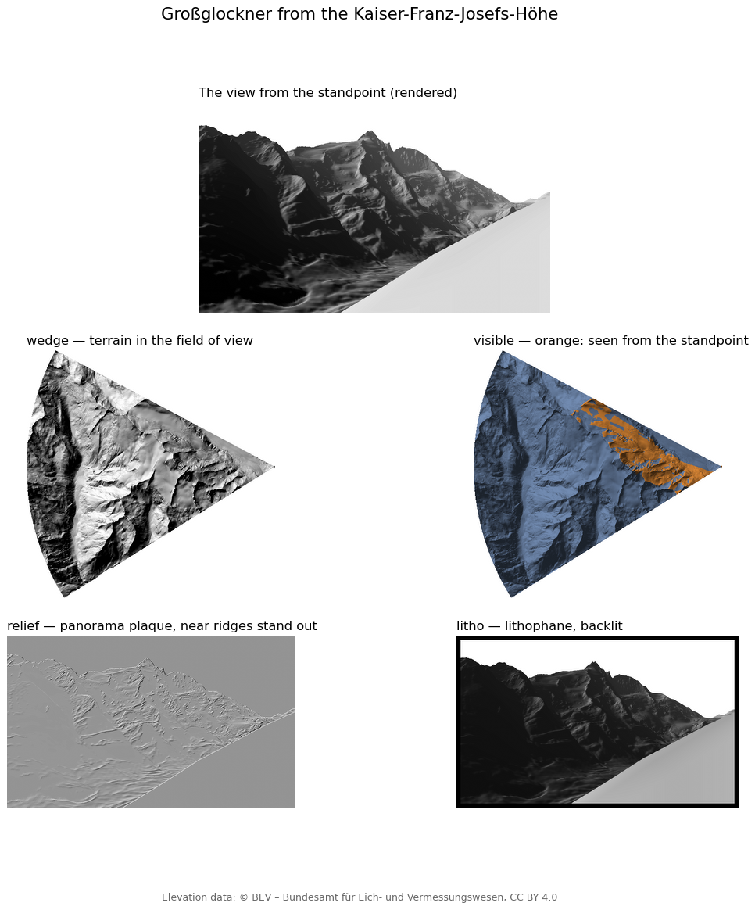

# dgm3d — 3D-printable terrain from Austria's 1 m elevation model

`dgm3d` turns the free **BEV ALS-DGM** (Austria's 1 m airborne-laser-scan terrain model) into
watertight STL files for 3D printing. You pick an area by coordinates or a standpoint and a
view direction. It reads only the part of the BEV tiles it needs over HTTP, so you never
download the multi-gigabyte source tiles.

- **Area reliefs:** any bounding box, from a single hillside up to all of Austria, optionally
  cut along the border
- **Views from a standpoint:** four ways to print what you see from a summit or a viewpoint
- **Print helpers:** exact print scale, vertical exaggeration, non-linear height compression
  and the layer heights for filament changes


*Example output of `dgm3d.py view --mode all`.*

## Install

Needs Python 3 with numpy and the GDAL bindings. scipy is optional.

```bash
# Fedora / RHEL
sudo dnf install python3-gdal python3-numpy python3-scipy
# Debian / Ubuntu
sudo apt install python3-gdal python3-numpy python3-scipy

git clone https://github.com/elronzo/dgm3d && cd dgm3d
./dgm3d.py --help
```

## Usage

### Area relief

```bash
# Kahlenberg / Leopoldsberg (Vienna), 180 mm wide
./dgm3d.py fetch 16.30 48.25 16.38 48.29 kahlenberg.stl --dem-res 2 --width 180 --exag 1.5
```

Coordinates are WGS84 decimal degrees in the order **west south east north**, so longitude
comes before latitude. In Google Maps, right-click a corner and click the coordinates to copy
them. Google gives *lat, lon*, so swap them.

The command writes the clipped GeoTIFF (`kahlenberg.tif`) next to the STL. To try other print
settings without downloading again, rebuild from that file:

```bash
./dgm3d.py stl kahlenberg.tif kahlenberg_flat.stl --width 180 --exag 1.0
```

### All of Austria (fits a Prusa MINI+, 180 × 180 mm)

```bash
./dgm3d.py fetch 9.53 46.37 17.17 49.02 austria.stl \
    --dem-res 250 --width 175 --res 0.2 --base 2 \
    --exag 4 --gamma 0.7 --crop --bands 1000,2500 --layer 0.1
```

- `--crop` cuts the model along the edge of the data, which is the Austrian border, instead of
  filling the rest of the rectangle with a flat plate.
- `--gamma 0.7` lifts low terrain relative to the peaks, so the Waldviertel and the
  Alpenvorland stay readable without turning the Alps into spikes. The highest point keeps its
  height.
- `--bands` prints the layer heights in mm at which to change filament, for example green,
  then grey, then white.

### Buildings

```bash
# a few blocks in Vienna-Donaustadt, ~1:3,400 on a 175 mm print
./dgm3d.py fetch 16.48334 48.21499 16.49131 48.21798 donaustadt.stl \
    --dem-res 1 --width 175 --res 0.2 --exag 1 --base 2 --buildings
```

`--buildings` adds three things to the terrain:

1. The BEV **surface model** (ALS-DSM, 1 m, CC BY 4.0), fetched on the same grid as the
   terrain model.
2. The **building footprints** from the BEV landscape model (DLM Bauwerke, CC BY 4.0). They
   are read remotely with a spatial filter and rasterised. Inside a footprint the model uses
   the surface height, which gives real roof shapes. Everywhere else it uses the terrain
   height, so trees are left out.
3. Two extra bodies for multi-colour printing: `_terrain.stl` and `_buildings.stl`. Together
   they make up the full model.

Buildings only work at large scales. With a 0.4 mm nozzle, anything narrower than about
0.8 mm on the print will not come out cleanly, and the tool prints that limit in metres.
Use areas of roughly 0.3–2 km.

Options:

- `--footprints FILE|URL` uses other building polygons. `--footprints none` takes everything
  more than 2.5 m above ground, trees included.
- `--footprint-where` and `--footprint-layers` select features or layers.
- `DLM_BUILDINGS=<url>` points to a newer DLM release.

**Vienna's own surface model (50 cm).** The City of Vienna (MA 41) publishes its surface model
at 50 cm resolution under CC BY 4.0, in 2.5 × 2.5 km sheets. To use it:

1. Open the [Geodatenviewer](https://www.wien.gv.at/ma41datenviewer/public/start.aspx).
2. Under *Geodaten Download*, select *Oberflächenmodell (DOM)*.
3. Click the sheet(s) covering your area and download the TIF files.

Then pass them to dgm3d:

```bash
./dgm3d.py fetch 16.48334 48.21499 16.49131 48.21798 donaustadt.stl \
    --dem-res 0.5 --width 175 --res 0.2 --exag 1 --base 2 \
    --buildings --dsm-files dom_*.tif --dsm-srs EPSG:31256
```

Vienna's heights are given relative to *Wiener Null*, not sea level. dgm3d matches the open
ground of the city's model to the BEV terrain model and prints the offset it found (about
+156.7 m). Credit: *Höhendaten: © Stadt Wien – data.wien.gv.at, CC BY 4.0, bearbeitet*.

### Views from a standpoint

```bash
# Kaiser-Franz-Josefs-Höhe, looking west at the Großglockner
./dgm3d.py view --lat 47.0748 --lon 12.7506 --az 268 --fov 60 --dist 12 --mode all --out glockner
```

`view` fetches the terrain for the field of view by itself. Pass `--dem file.tif` to use your
own GeoTIFF instead. Ray casting accounts for Earth curvature and atmospheric refraction.

| Mode | Output | What it is |
|---|---|---|
| `wedge` | `_wedge.stl` | Pie slice of terrain, with its tip at the standpoint and opening along the view direction |
| `visible` | `_visible.stl` + `_hidden.stl` | The same wedge split into what you can and can't see from the standpoint. Two bodies for multi-colour printing that together form the whole wedge |
| | `_visible_engraved.stl` | Single-colour variant: hidden terrain sunk by `--sink` mm |
| `relief` | `_relief.stl` | Bas-relief plaque of the panorama: near ridges stand out further than distant ones. Print face up and stand it upright |
| `litho` | `_litho.stl` | Lithophane of the rendered view. Print upright in white PLA at 100 % infill and hold it against a window |
| `all` | all of the above | Also writes a PNG preview for each mode |

Useful options: `--eye` (eye height above ground, e.g. for a lookout tower), `--vstretch`
(vertical stretch of the panorama, chosen automatically if omitted), `--bottom` (lower edge of
the view in degrees), `--sun-az` / `--sun-alt` (shading).

Tips:

- From a valley floor you often see very little. Summits, ridges or a higher `--eye` give
  better panoramas.
- Outside Austria the BEV data has no values. That terrain is printed flat, or cut away with
  `--crop`.

## Data source

Elevation data: **© BEV – Bundesamt für Eich- und Vermessungswesen**,
[CC BY 4.0](https://creativecommons.org/licenses/by/4.0/), <https://data.bev.gv.at>.

Models made with dgm3d are adaptations of this data. If you share or sell them, credit the
source, for example:

> Höhendaten: © BEV – Bundesamt für Eich- und Vermessungswesen, CC BY 4.0, bearbeitet

The tool uses the 2023 release by default. To use a newer one, set `STAND`, e.g.
`STAND=20240915 ./dgm3d.py …`. If BEV changes how its download folders are named, the tool
reports that no tile was found.

## License

The **code** is licensed under the [PolyForm Noncommercial License 1.0.0](LICENSE.md). Free
for personal, educational, research and other noncommercial use. **Commercial use is not
permitted**, including offering it as a service or selling prints made with it as a business.
For a commercial license, please get in touch.

The **elevation data** is not covered by this license. It remains under CC BY 4.0 from BEV
(see above).

## README image

`tools/readme_image.py` combines the previews of a `view --mode all` run into one picture
(needs matplotlib):

```bash
./dgm3d.py view --lat 47.0748 --lon 12.7506 --az 268 --fov 60 --dist 12 --mode all --out fjh
tools/readme_image.py fjh --title "Großglockner from the Kaiser-Franz-Josefs-Höhe"
```

## Development

```bash
python3 -m pytest -q
```

The tests run offline on synthetic terrain. They include a small local HTTP server that stands
in for the BEV download server. Every generated mesh is checked to be closed and consistently
oriented.

Contributions are welcome. By submitting a pull request you agree that the author may license
your contribution under the PolyForm Noncommercial License and under other terms, including
commercial ones.
